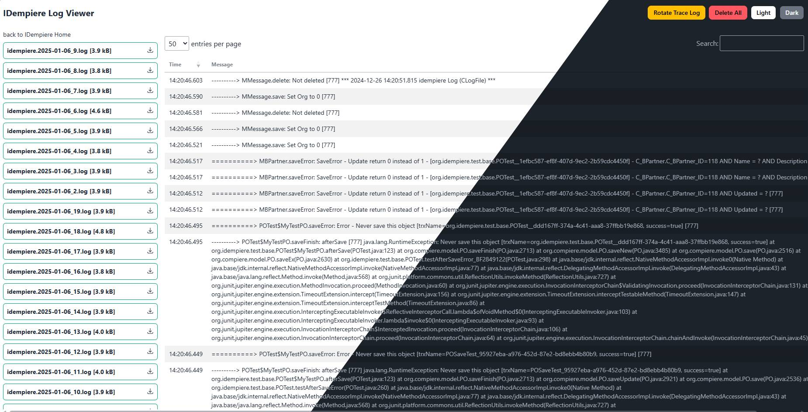

# iDempiere Log Viewer

**Summary:** A web page for viewing and managing iDempiere server trace logs from the browser, so you don't need shell access to the server.

## 🚀 Features

* **View Logs:** Browse the trace log files and open them in the browser, with a light and a dark theme.
* **Download Logs:** Save a log file to your computer.
* **Rotate Logs:** Start a new trace log file to make monitoring easier.
* **Delete Logs:** Remove old trace logs to free up disk space.
* **Configurable Size Limit:** Files bigger than a set size are not loaded in the browser, so a very large log doesn't slow the server down.

## ⚙️ Compatibility

* **iDempiere Version:** 12.0 and later
* **Java Version:** 17+
* **Database:** Any (PostgreSQL, Oracle)

## 📦 Database Changes

None. This extension adds no dictionary entries and runs no migration scripts.

## 🛠 Usage & Configuration

After installation, open `<idempiere url>/log-viewer` and sign in.

* **Access:** The user must be an Administrator or have URL form access to `/idempiereMonitor`, the same rule as the iDempiere Server Monitor. If SSO is enabled for the monitor (`ENABLE_SSO_IDEMPIERE_MONITOR`), the log viewer uses it too.
* **Size limit:** To change the largest file the browser will load, create a System Configurator record named `LOG_VIEWER_LIMIT_SIZE` and set the value in bytes. The default is `50000000` (50 MB).

## 📸 Screenshots

*Figure 1: The log viewer in dark and light themes.*

## 👤 Author / Support

* **Developer:** Reka Estu Digital
* **Source Code:** [https://github.com/uthadehikaru/idempiere-log-viewer](https://github.com/uthadehikaru/idempiere-log-viewer)
* **Issue Tracker:** [https://github.com/uthadehikaru/idempiere-log-viewer/issues](https://github.com/uthadehikaru/idempiere-log-viewer/issues)
